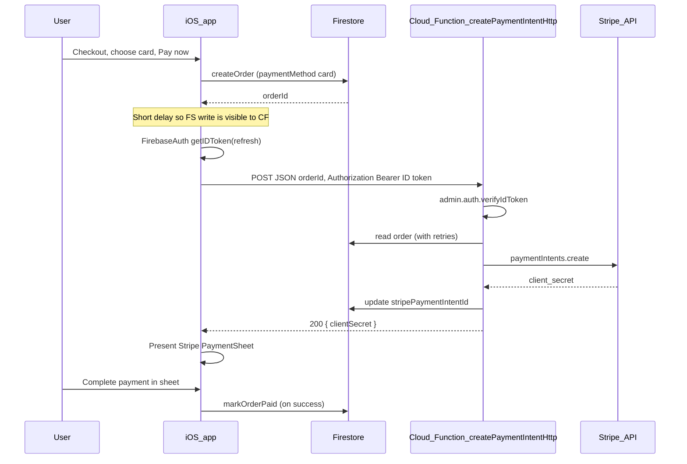

# Stripe and Firebase payments (Stampy)

This document describes how card payments are wired through **Stripe**, **Firebase Authentication**, **Cloud Functions**, and **Firestore**, and what was implemented to make the flow reliable on iOS.

## Overview

- **Cash on delivery**: The app creates an order in Firestore only. No Stripe server call.
- **Card**: The app creates an order in Firestore, then asks the backend for a Stripe **PaymentIntent** `clientSecret`. The **Stripe PaymentSheet** collects the card and confirms payment. Optionally, a **Stripe webhook** can mark the order paid when Stripe confirms success.

The **amount charged** always comes from the order document on the server (Firestore), never from client-supplied totals alone.

---

## End-to-end card flow



---

## iOS configuration

| Concern | Where |
|--------|--------|
| Firebase bootstrap | `Stampy/App/StampyApp.swift` — `FirebaseApp.configure()` |
| Stripe publishable key | `Config/Secrets.xcconfig` (`STRIPE_PUBLISHABLE_KEY`), gitignored. Copy `Config/Secrets.example.xcconfig`. `StripeConfig.publishableKey` reads it from Info.plist. |
| PaymentIntent HTTP base URL | `StripeConfig.createPaymentIntentURL` — defaults to 1st gen Cloud Functions URL pattern (see below) |
| Payment network call | `Stampy/Sources/Services/StripePaymentBackendService.swift` — `URLSession` `POST` with `Authorization: Bearer <Firebase ID token>` and JSON body `{ "orderId": "<id>" }` |
| Checkout UI | `Stampy/Sources/Views/Checkout/CheckoutPaymentMethodView.swift` — creates order, calls backend, presents PaymentSheet |

`StampyApp` also sets `StripeAPI.defaultPublishableKey` so PaymentSheet can initialize.

### Default PaymentIntent URL

For project `stampy-90571`, region `us-central1`, function name `createPaymentIntentHttp`, the default URL is:

`https://us-central1-stampy-90571.cloudfunctions.net/createPaymentIntentHttp`

This must match the **HTTPS trigger URL** shown in Firebase Console → Functions after deploy.

### Optional URL override (Info.plist)

If Firebase ever shows a **different** trigger URL (for example some Cloud Run–backed setups), add a string key to the app target’s **Info** (Custom iOS Target Properties):

- **Key**: `StripePaymentIntentEndpointURL`
- **Value**: full HTTPS URL from the console, no trailing slash unless required

`StripeConfig.createPaymentIntentURL` reads this key when present and non-empty; otherwise it uses the default regional URL above.

---

## Cloud Functions (`functions/index.js`)

All exported functions use region **`us-central1`** (must stay in sync with `StripeConfig.functionsRegion`).

### Secrets and config (runtime)

Configured with Firebase Functions legacy config (not committed):

```bash
firebase functions:config:set stripe.secret="sk_..." stripe.webhook_secret="whsec_..." --project stampy-90571
```

- **`stripe.secret`**: Stripe **secret** API key (test or live). Used to create PaymentIntents and verify webhooks.
- **`stripe.webhook_secret`**: Signing secret from the Stripe Dashboard for the webhook endpoint pointing at `stripeWebhook`.

### `createPaymentIntentHttp` (primary path for the iOS app)

- **Type**: HTTP (`onRequest`).
- **Auth**: `Authorization: Bearer <Firebase ID token>`. The handler uses `admin.auth().verifyIdToken`.
- **Body**: JSON `{ "orderId": "<firestore document id>" }`. The handler also parses `req.rawBody` when `req.body` is not already JSON (Firebase/runtime quirks).
- **Behavior**: Loads the order with **retries** (handles brief lag after the client write), checks `buyerId` matches the token UID, checks `paymentMethod === "card"`, computes amount in cents from `totalPrice`, creates a Stripe PaymentIntent, stores `stripePaymentIntentId` on the order, returns `{ "clientSecret": "..." }`.
- **Why HTTP instead of only callable**: Some clients hit **UNAUTHENTICATED** on callable invocations even when the user is signed in. The HTTP route sends the same ID token explicitly and verifies it in code, avoiding that gateway behavior.

### `createPaymentIntent` (callable, optional)

- **Type**: Callable (`onCall`).
- **Auth**: `context.auth` and/or `idToken` in the callable payload (`resolveCallerUid`).
- **Same business logic** as HTTP via shared `runCreatePaymentIntent`.

### `stripeWebhook`

- **Type**: HTTP `onRequest`.
- **Stripe** posts events with signature header; raw body is verified with `stripe.webhooks.constructEvent`.
- On `payment_intent.succeeded`, reads `metadata.orderId` and updates the Firestore order `status` to **paid**.

---

## Firestore

- Orders live in collection **`orders`**.
- Client creates documents with **`OrderService`**; rules should require authenticated users and that `buyerId` matches `request.auth.uid` (see `firestore.rules`).

The Cloud Function **never trusts** client-supplied totals for charging: it reads **`totalPrice`** from the stored order.

---

## Deployment

From the repository root:

```bash
firebase deploy --only functions --project stampy-90571
```

**Node.js**: Recent **Firebase CLI** versions require **Node ≥ 20**. If your machine only has Node 18, either upgrade Node or invoke a compatible CLI, for example:

```bash
npx firebase-tools@13.0.0 deploy --only functions --project stampy-90571
```

After deploy, confirm in the console (or CLI `functions:list`) that **`createPaymentIntentHttp`** exists in **`us-central1`** and copy its HTTPS URL if it differs from the default in `StripeConfig`.

---

## Troubleshooting

| Symptom | Likely cause | What to do |
|--------|----------------|------------|
| Alert about **payment endpoint not found (404)** with no JSON `error` from your function | Request never reached your function (wrong URL, function not deployed, wrong project/region) | Deploy functions; compare Console HTTPS URL to `StripeConfig`; set `StripePaymentIntentEndpointURL` if needed. Smoke test: `POST` without `Authorization` should return **401** JSON, not a generic HTML 404. |
| **401** / invalid token from `createPaymentIntentHttp` | Expired or invalid Firebase ID token | Ensure user is signed in; sign out and sign in; app refreshes token before the request. |
| **404** JSON: order not found | Firestore document not visible yet or wrong project | Short delay after `createOrder` is already in the app; backend retries reads; verify app and Functions use the same Firebase project and `(default)` database. |
| **403** not your order | `buyerId` on order does not match token UID | Check order creation uses `Auth.auth().currentUser.uid`. |
| Callable **UNAUTHENTICATED** if you switch back to callable-only | Known iOS/callable edge cases | Prefer **`createPaymentIntentHttp`** as implemented. |
| Webhook not updating orders | `stripe.webhook_secret` missing or wrong URL in Stripe Dashboard | Set config; point Stripe webhook to the deployed `stripeWebhook` URL; use correct signing secret. |

---

## Key files

| File | Role |
|------|------|
| `Config/Secrets.xcconfig` | Local Stripe publishable key. Not committed. |
| `Stampy/Sources/Services/StripeConfig.swift` | Project id, region, PaymentIntent URL, and the publishable-key lookup |
| `Stampy/Sources/Services/StripePaymentBackendService.swift` | HTTP client for PaymentIntent |
| `Stampy/Sources/Services/OrderService.swift` | Firestore order create / mark paid |
| `Stampy/Sources/Views/Checkout/CheckoutPaymentMethodView.swift` | Checkout and card flow orchestration |
| `Stampy/App/StampyApp.swift` | Firebase + Stripe publishable key init |
| `functions/index.js` | `createPaymentIntentHttp`, `createPaymentIntent`, `stripeWebhook` |
| `firestore.rules` | Security rules for `orders` and related collections |
| `firebase.json` | Firebase project wiring (functions source, Firestore rules) |

---

## Security notes

- Never commit Stripe **secret** keys or webhook secrets to git. Use `firebase functions:config:set` (or newer **Secret Manager** patterns if you migrate).
- The **publishable** key ships inside the built app. Keep it in `Config/Secrets.xcconfig`, not in source. The **secret** key must only exist on the server (Cloud Functions).
- `GoogleService-Info.plist` stays on your machine. Download a fresh copy from Firebase if the key that was previously public is still unrestricted.
